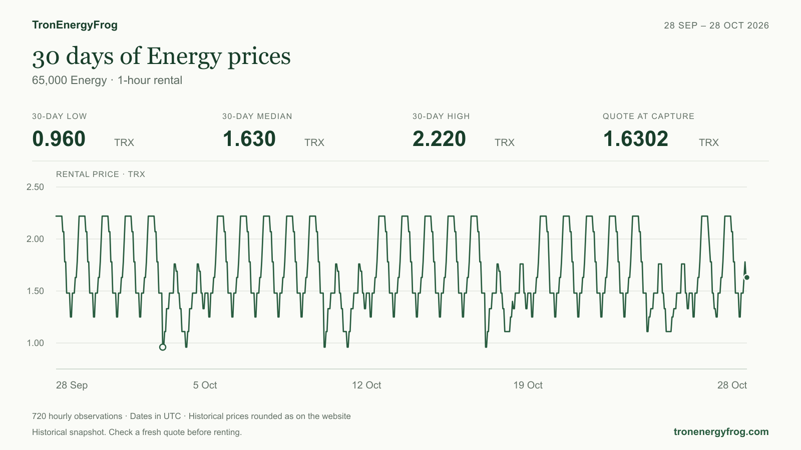

<a href="https://tronenergyfrog.com/"></a>

# TRON Energy rental API · TronEnergyFrog

[← Back to the product overview](README.md)

TRON Energy rental for people, applications, and AI agents.

Rent Energy for USDT TRC-20 transfers at **up to 80% less than the equivalent TRX burn cost**. Use the website as a guest, use the Telegram Bot, or connect through the regular API or x402 payment flow.

[Website](https://tronenergyfrog.com/) · [Telegram Bot — @tron_energy_frog_bot](https://t.me/tron_energy_frog_bot) · [API reference](https://api.tronenergyfrog.com/v1/docs) · [x402 guide](https://tronenergyfrog.com/x402)

Savings depend on current rates and network costs. This comparison covers Energy, not Bandwidth or separate account activation charges.

## Choose your entry point

| Interface | Access | Payment |
| --- | --- | --- |
| [Guest checkout](https://tronenergyfrog.com/) | No registration | TRX payment for the rental |
| [Telegram Bot](https://t.me/tron_energy_frog_bot) | Start the bot | TRX account balance |
| [Regular API](https://api.tronenergyfrog.com/v1/docs) | Account API key, Bearer authentication | TRX account balance |
| [x402 API](https://tronenergyfrog.com/x402) | No registration or API key | USDC on Base or Solana |

Guest checkout uses payment wallets we have already activated. Your payment avoids the extra fee for activating its receiving address; normal TRON Bandwidth fees can still apply.

## Regular API

Base URL: `https://api.tronenergyfrog.com`

Generate a key in the [Telegram Bot](https://t.me/tron_energy_frog_bot) under **Account → Generate API key**. Send it in the `Authorization` header:

```http
Authorization: Bearer <API_KEY>
```

The [API reference](https://api.tronenergyfrog.com/v1/docs) documents request bodies, response schemas, and errors. The main workflow is to request a quote, submit it, and follow the returned operation ID.

| Method and path | Purpose |
| --- | --- |
| `GET /v1/profile` | Read account information and balance |
| `POST /v1/rates/energy` | Check the current rental rate |
| `GET /v1/rates/network-fees/:target_address` | Estimate Energy for the USDT recipient |
| `POST /v1/quotes/energy` | Create an Energy rental quote |
| `POST /v1/rental` | Submit a quoted rental |
| `POST /v1/rental/auto` | Quote and submit a rental in one request |
| `POST /v1/quotes/activation` | Quote activation of a new TRON address |
| `POST /v1/activation` | Submit wallet activation |
| `GET /v1/operations/:id` | Check progress |
| `GET /v1/wallets` | List saved wallets |
| `GET /v1/rentals` | Read rental history |
| `GET /v1/transactions` | Read transaction history |

## x402 payments for AI agents

The open x402 v2 flow lets an agent buy an Energy rental without creating an account, obtaining an API key, or topping up a balance. It pays in **USDC on Base (preferred) or Solana**. The rental delivers **Energy to a TRON address**.

Start with a read-only discovery request:

```sh
curl https://api.tronenergyfrog.com/v1/x402
```

Check `available`, then follow the endpoints returned by discovery:

| Step | Request |
| --- | --- |
| Create a free quote | `POST /v1/x402/quotes` |
| Get the payment challenge | `POST /v1/x402/rentals/{quote_id}` |
| Pay and submit | Retry that POST with `PAYMENT-SIGNATURE` |
| Track payment and delivery | `GET /v1/x402/rentals/{quote_id}` |

The first payment request returns HTTP `402` with `PAYMENT-REQUIRED`. Use a compatible x402 client and the agent's wallet to satisfy one accepted option. Read the amount, network, token, recipient, and expiry from that challenge. After payment, poll the returned status URL to confirm Energy delivery; settlement and fulfillment are separate states.

[x402 integration guide](https://tronenergyfrog.com/x402) · [Request and response schemas](https://api.tronenergyfrog.com/v1/docs#/x402)

## Tools for the person using your integration

The [live Energy calculator](https://tronenergyfrog.com/tron-energy-calculator) checks the USDT **receiver's** balance and recent network data to estimate required Energy and compare rental with burn cost. Rent to the **sender's** wallet, since it pays the transfer's resource cost. Presets include 65K and 130K; custom amounts must meet the minimum shown by the service. Estimates are not guaranteed transaction requirements.

The [wallet activation service](https://tronenergyfrog.com/tron-wallet-activation) activates a newly generated public address on TRON. It requires an account and a separate quote. Activation does not supply a rental's Energy, and the customer's private keys stay in their wallet.

The [Telegram Bot](https://t.me/tron_energy_frog_bot) also provides rentals, Energy checks, account access, and website login codes. For a one-off rental, [guest checkout](https://tronenergyfrog.com/) needs no registration.

## Historical prices

The website's [live and historical pricing](https://tronenergyfrog.com/tron-energy-price) helps users compare a current quote with earlier rates. This attached **30-day view ending 28 October 2026** covers **65,000 Energy for one hour**:

| Metric | TRX |
| --- | ---: |
| Low | 0.960 |
| Median | 1.630 |
| High | 2.220 |
| Quote at capture | 1.6302 |

[](https://tronenergyfrog.com/tron-energy-price)

Redrawn from 720 hourly rates published by TronEnergyFrog, captured on 28 October 2026. Historical values use the same rounding as the website. [Download the chart data](assets/price-history-30-days.csv). Fetch a fresh quote for each order; do not hard-code these historical prices into a client.

## Links

[TronEnergyFrog](https://tronenergyfrog.com/) · [Guides](https://tronenergyfrog.com/guides) · [Telegram Bot](https://t.me/tron_energy_frog_bot) · [YouTube](https://www.youtube.com/@TronEnergyFrog) · [Support](mailto:support@tronenergyfrog.com) · [Terms & privacy](https://tronenergyfrog.com/terms)

TronEnergyFrog operates independently and is not affiliated with the TRON Foundation.
