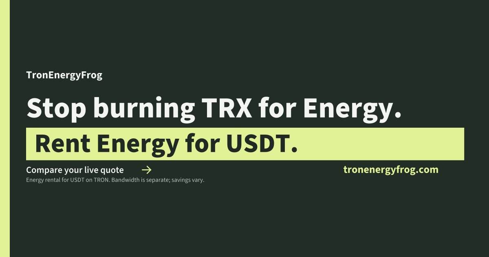
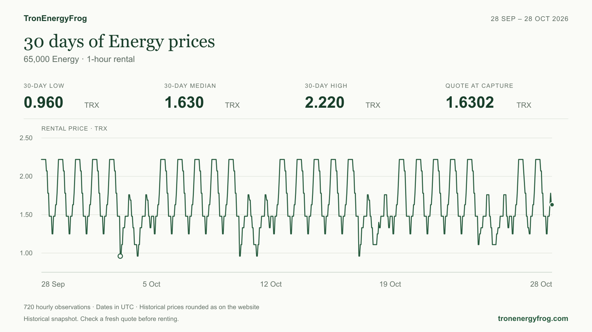

# Rent TRON Energy with TronEnergyFrog

**Up to 80% less than burning TRX for Energy. No registration needed for guest rentals.**

[Rent Energy](https://tronenergyfrog.com/) · [Telegram Bot](https://t.me/tron_energy_frog_bot) · [Live calculator](https://tronenergyfrog.com/tron-energy-calculator) · [API overview](DEVELOPERS.md) · [x402 for AI](https://tronenergyfrog.com/x402)

TronEnergyFrog is a TRON Energy rental service for USDT TRC-20 transfers. Check the amount, compare the price, and get Energy delegated to your sending wallet for the rental period. Your private keys stay in your wallet.

Savings vary with the quote and network costs. The 80% comparison applies to Energy, with Bandwidth and separate activation costs excluded.

## One transfer or part of your daily workflow

| What you need | Where to start |
| --- | --- |
| A quick rental without an account | [Guest checkout](https://tronenergyfrog.com/). Enter your public TRON address, choose Energy and duration, and pay in TRX. |
| The right amount of Energy | [Live TRON Energy calculator](https://tronenergyfrog.com/tron-energy-calculator). Check the USDT receiver's balance and current Energy estimates before choosing a package. |
| A price you can compare | [TRON Energy prices and history](https://tronenergyfrog.com/tron-energy-price). See how the current offer compares with recorded prices. |
| A newly created wallet activated | [TRON wallet activation](https://tronenergyfrog.com/tron-wallet-activation). Sign in and activate an address you control, using only its public address. |
| Rent through the Telegram Bot | [Telegram Bot — @tron_energy_frog_bot](https://t.me/tron_energy_frog_bot). Rent Energy, check transfer requirements, and access your account. |
| An integration for your app | [Regular API](https://api.tronenergyfrog.com/v1/docs). Quotes, rentals, activation, balances, saved wallets, and history with an account API key. |
| Payments from an AI agent | [x402 API](https://tronenergyfrog.com/x402). USDC on Base or Solana, without registration, an API key, or a prepaid balance. |

**Lower payment overhead, too.** Guest payment wallets are already activated by us, so you do not pay an extra activation fee for the receiving payment address. Normal TRON Bandwidth fees may still apply.

## Before you send

1. Check the **USDT receiver** in the [calculator](https://tronenergyfrog.com/tron-energy-calculator).
2. Rent Energy to the **sender's wallet** on the [website](https://tronenergyfrog.com/) or through the [Telegram Bot](https://t.me/tron_energy_frog_bot).
3. Wait for delivery, then send USDT from your own wallet.

Choose 65K, 130K, or a custom amount that meets the current minimum. The calculator gives an estimate; review your wallet's final transaction requirements before signing.

## A month of prices, at a glance

**65,000 Energy · 1 hour · 30-day view ending 28 October 2026**

| Low | Median | High | Quote at capture |
| ---: | ---: | ---: | ---: |
| 0.960 TRX | 1.630 TRX | 2.220 TRX | 1.6302 TRX |

Redrawn from 720 hourly rates published by TronEnergyFrog, captured on 28 October 2026. Historical values use the same rounding as the website. [Download the chart data](assets/price-history-30-days.csv). These historical prices give context; request a fresh quote before renting. [See current prices and history →](https://tronenergyfrog.com/tron-energy-price)

## TRON Energy rental: common questions

### Can I rent TRX Energy?

If you are looking to rent TRX Energy, you are looking for Energy on the TRON network. TRX is the network's native coin; Energy is the resource used to execute smart contracts, including USDT transfers. [Rent TRON Energy](https://tronenergyfrog.com/) to cover that resource cost.

### Can I buy TRON Energy?

People often use “buy TRON Energy” to mean paying for an Energy rental. At TronEnergyFrog, Energy is delegated to your wallet for the selected rental period. It is temporary access to a network resource, so plan to use it within that period.

### How do I reduce USDT TRC-20 transfer fees?

Check the receiver with the [Energy calculator](https://tronenergyfrog.com/tron-energy-calculator), compare the rental quote with the estimated Energy burn cost, and rent to the sending wallet before transferring. Bandwidth is separate. Our [USDT TRC-20 transfer fee guide](https://tronenergyfrog.com/guides/usdt-trc20-transfer-fees) explains what makes up the fee.

## Are you a developer?

Start with our **[API overview for developers](DEVELOPERS.md)** for authentication, rental endpoints, and the x402 payment flow.

**Regular API:** generate a key through **Account → Generate API key** in the [Telegram Bot](https://t.me/tron_energy_frog_bot). Use `Authorization: Bearer <API_KEY>` for account-based operations settled in TRX. [API reference →](https://api.tronenergyfrog.com/v1/docs)

**x402 API:** discover available payment options, create a quote, answer the HTTP 402 payment challenge, and follow the rental status. AI agents pay in USDC on Base (preferred) or Solana; Energy is delivered on TRON. The returned challenge supplies the exact payment details. [Integration guide →](https://tronenergyfrog.com/x402) · [Discovery JSON →](https://api.tronenergyfrog.com/v1/x402)

**MCP server for AI agents:** give Claude, Cursor or any MCP client live TRON Energy prices, x402 quotes and Energy rental. Run `npx -y tronenergyfrog-mcp`; an API key or a Base wallet is optional. [Setup and tools →](mcp/README.md)

---

**[Open TronEnergyFrog](https://tronenergyfrog.com/)** · [Guides](https://tronenergyfrog.com/guides) · [YouTube](https://www.youtube.com/@TronEnergyFrog) · [Support](mailto:support@tronenergyfrog.com) · [Terms & privacy](https://tronenergyfrog.com/terms)

TronEnergyFrog is independent of the TRON Foundation.
